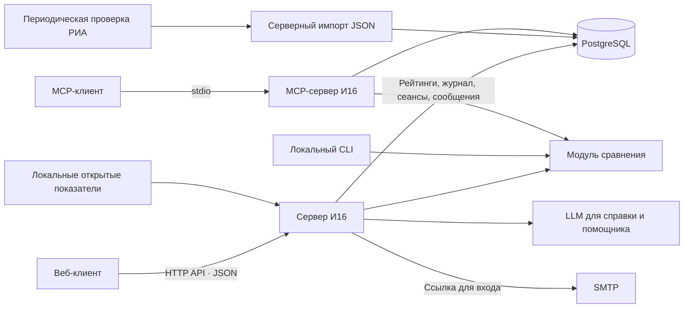

# Архитектура И16

Веб-клиент показывает форму сравнения и справку в [стиле И16](visual-style.md). Сервер отвечает за проверку запроса, получение данных и расчёт. Веб-клиент обращается к PostgreSQL через сервер. Выбор темы хранится в `localStorage` текущего браузера. Печатная справка использует светлую палитру.

## Данные и импорт

Миграция `001_initial.sql` создаёт таблицы рейтинга. Определения исходных значений приведены в [контракте импорта](data-contract.md).

| Таблица       | Ключ                            | Содержимое                                                                                                                                                                                                                                                                                          |
| -------------------- | ----------------------------------- | ------------------------------------------------------------------------------------------------------------------------------------------------------------------------------------------------------------------------------------------------------------------------------------------------------------- |
| `ratings`          | `rating_id`                       | Название рейтинга, признак демонстрационных или рабочих данных                                                                                                                                                                                         |
| `subjects`         | `(rating_id, subject_id)`         | Имя субъекта в этом рейтинге                                                                                                                                                                                                                                                          |
| `rating_snapshots` | `(rating_id, period)`             | Версия методики, границы шкалы, идентификатор охвата и размер рейтинга, название и ссылка источника, дата публикации и дополнительная ссылка на таблицу при наличии |
| `rating_results`   | `(rating_id, period, subject_id)` | Опубликованное место и балл                                                                                                                                                                                                                                                           |

Результаты ссылаются на срез и субъекта по внешним ключам. Таблица допускает равные места и пропуски. Баллы и границы шкалы хранятся как `numeric`. Сравнение читает согласованный снимок базы в транзакции `REPEATABLE READ`. Строка подключения задаётся через `DATABASE_URL`.

CLI-импорт заменяет результаты только для периодов из JSON. Ручная и плановая проверки РИА тем же способом обновляют изменившиеся срезы. Импорт из админки добавляет новые рейтинги или годы. При совпадении периода, несовпадении названия или типа рейтинга либо имени существующего субъекта импорт завершается с `409`. Каждая загрузка выполняется одной транзакцией.

`002_refresh_history.sql` создаёт журнал проверок `rating_refresh_runs`. `003_email_access.sql` добавляет `workspace_users`, `workspace_email_links` и `workspace_sessions`. `004_feedback.sql` создаёт `feedback_messages` для входящих сообщений. Выполненные миграции регистрируются в `i16_schema_migrations`.

## HTTP API

Локальный сервер слушает `127.0.0.1`. Аргумент `--rating-id` задаёт рейтинг по умолчанию для веб-клиента и рейтинг для аналитики администратора. Для справочника, сравнения, карты и справки можно передать `rating_id` в URL. Веб-клиент и API обслуживаются с одного адреса.

| Запрос                                                                                       | Результат                                                                                                                                                                                                                                                                                                                                                                                                                                                   |
| -------------------------------------------------------------------------------------------------- | -------------------------------------------------------------------------------------------------------------------------------------------------------------------------------------------------------------------------------------------------------------------------------------------------------------------------------------------------------------------------------------------------------------------------------------------------------------------- |
| `GET /api/v1/rating` | Название, ID и тип рейтинга, годы, справочник субъектов, рекомендуемый базовый период и ID субъектов на местах 1–3 по годам. |
| `GET /api/v1/comparisons?period=2025&baseline=2024&subject=demo-a&subject=demo-b&subject=demo-c` | JSON со строками сравнения в порядке показа, кратким итогом, сведениями об источниках и ограничениями. `subject` передаётся отдельно для каждого выбранного ID. Необязательные `baseline` и `focus_subject` включают сравнение с базой и разрывы по опорному субъекту. |
| `GET /api/v1/map?period=2025&baseline=2024` | Периоды, опубликованные значения и рассчитанные дельты всех доступных субъектов. Использует тот же модуль сравнения. База необязательна. |
| `GET /api/v1/refresh` | Состояние периодической проверки РИА и время последней и следующей проверок. |
| `GET /api/v1/ai-ranking` | Ряды ИИ для регионов загруженного рейтинга РИА, отсортированные по месту. Ответ `rankings` содержит период, источник, строки и единицы. |
| `POST /api/v1/feedback` | Принимает JSON с `message` от 3 до 3 000 символов и необязательным `email`. Возвращает `201` после записи и `400` при неверных полях. |
| `GET /admin/` | Панель с проверкой РИА, аналитикой и каталогом источников. Требует Basic Auth при настроенном `I16_ADMIN_PASSWORD_FILE`. |
| `POST /admin/api/v1/refresh` | Требует Basic Auth и пустой JSON-объект. Возвращает `202` при принятии, `409` при текущей проверке, `503` при отключённом обработчике. |
| `GET /admin/api/v1/analytics` | Покрытие выпусков, пропуски, сводка проверок за 30 суток и последние 10 записей. Требует Basic Auth. |
| `GET /admin/api/v1/feedback` | До 100 последних сообщений разработчику с датой и необязательным контактом. Требует Basic Auth. |
| `GET /admin/example.json` | Образец JSON для импорта через админку. Требует Basic Auth. |
| `GET /admin/api/v1/sources` | Каталог выпусков с их источниками. Требует Basic Auth. |
| `POST /admin/api/v1/sources` | Транзакционное добавление JSON-набора до 2 МиБ. Требует Basic Auth. Возвращает `201` при импорте, `409` при конфликте. |
| `GET /login/` | Страница входа по одноразовой почтовой ссылке. |
| `GET /workspace/` | Рабочая область. При отсутствии сессии перенаправляет на `/login/`. |
| `POST /auth/api/v1/email` | Принимает JSON с `email`. Возвращает `202` при принятии запроса, включая превышение частоты отправки. При недоступном SMTP возвращает `503`. |
| `POST /auth/api/v1/verify` | Принимает JSON с `token` из ссылки. Возвращает `200` с cookie сессии или `400` для недействительной ссылки. |
| `GET /workspace/api/v1/ratings` | Email пользователя и каталог рейтингов с периодами. Требует действующую сессию. |
| `POST /auth/api/v1/logout` | По пустому JSON-объекту завершает текущую сессию и очищает cookie. |
| `POST /api/v1/help` | JSON с `question` длиной 1–280 символов, `page` из `rating`, `workspace`, `login`, `admin` и необязательным `section` с якорем. Ответ содержит `mode` (`llm` или `reference`), `answer` и `topics`. |
| `POST /api/v1/briefs`                                                                            | Формирует справку с помощью ИИ для JSON-запроса с `period`, `subject_ids` и необязательными `baseline` и `focus_subject_id`. Возвращает тот же состав данных, включая краткий итог и `brief_mode` со значением `ai_assisted` или `template`.                                                                                         |

В успешном сравнении возвращаются выбранные периоды, размер рейтинга за каждый из них, исходные места и баллы, запрошенные дельты, разрывы при выборе опорного субъекта и признак частичной справки. Места и их дельты передаются целыми числами. Баллы, их дельты и разрывы передаются десятичными строками с точкой, пропуски — как JSON `null`. Клиент применяет русский формат отображения. Для `GET /api/v1/comparisons` используется `brief_mode: template`.

Успешная и частичная справки возвращаются с HTTP `200`. Некорректный запрос или полное отсутствие текущих значений у выбранных субъектов возвращает `400`, незагруженный рейтинг — `404`, недоступная база — `503`. Ошибки содержат `error.code` и `error.message`. Для POST передавайте тело `application/json` до 64 КиБ. Импорт принимает исходный JSON-файл до 2 МиБ.

Клиент связывает показатели карты с локальными контурами `russia-regions.json` по `subject_id`. Контуры обобщены из Natural Earth Admin 1 версии 5.1.2 в конической проекции для обозрения России. Это справочная геометрия для визуализации статистики. [Источник геометрии](https://www.naturalearthdata.com/downloads/10m-cultural-vectors/10m-admin-1-states-provinces/), [условия использования](https://www.naturalearthdata.com/about/terms-of-use/).

Для рейтинга РИА HTTP-сравнение добавляет `public_indicators` со справочными рядами по `subject_id` и ссылками на карты связи. Сервер читает отдельный файл [по контракту](data-contract.md#дополнительные-показатели-регионов) при запуске. Для отсутствующего значения возвращается `null`. Расчёты, хранилище рейтингов и входные факты для LLM используют обычные срезы.

Фоновая проверка РИА загружает страницу по HTTPS, сверяет контрольную выборку и передаёт изменившиеся срезы в транзакционный импорт PostgreSQL. Веб-запросы обслуживаются независимо от этой проверки. MCP-сервер запускается как локальный подпроцесс клиента и использует общий модуль сравнения и формы ответов HTTP API.

Ручная и плановая проверки используют один рабочий поток. Для путей `/admin/` сервер проверяет Basic Auth. Если администратор не настроен, эти маршруты возвращают `404`. При неверных учётных данных ответ `401` содержит `WWW-Authenticate`.

Форма обратной связи публичная. PostgreSQL хранит сообщение, время его получения и необязательный email в `feedback_messages`. История доступна через защищённый административный маршрут.

Таблица `rating_refresh_runs` хранит завершённые проверки по ID рейтинга, включая проверки до первого успешного импорта. Защищённая аналитика читает покрытие, счётчики и недавние записи в одной транзакции `REPEATABLE READ`.

Почтовая ссылка действует 15 минут и передаёт токен во фрагменте URL. Клиент отправляет токен серверу после нажатия «Подтвердить вход». Погашение ссылки, создание учётной записи и семидневной сессии происходят в одной транзакции. Выдача писем ограничена одним запросом на адрес в минуту и 30 запросами в минуту на базу. Сессионная cookie имеет `HttpOnly` и `SameSite=Lax`. При внешнем HTTPS-адресе она также имеет `Secure`.

Сессия требуется для рабочей области и её каталога. Страница сравнения и `/api/v1/` доступны без входа. Сервер принимает локальный `Host` и внешний `Host` из `I16_AUTH_BASE_URL`. Если POST содержит `Origin`, происхождение должно совпасть с адресом сервиса.

Помощник подбирает записи справочника по вопросу и текущему разделу. Сервер отправляет модели вопрос и одну найденную запись или предлагает выбрать ID из нескольких записей. При отсутствии совпадений отправляется весь справочник. Сервер проверяет форму ответа и ID тем. При отказе модели сервер возвращает подходящие ID справочника и `answer: null`. При пустом списке тем клиент предлагает примеры вопросов. Клиент показывает источник текста и собирает ссылки из справочника. Помощник и справки используют общий серверный клиент OpenAI-совместимого шлюза.

## Формирование справки

Сервер строит пакет вариантов формулировок из рассчитанных фактов. Каждый вариант связан с идентификатором факта. Модель получает схему с допустимыми ID и вариантами и возвращает упорядоченный список. Для шлюза, который отклоняет схему, используется обычный JSON-ответ. Сервер всегда проверяет известность ID, отсутствие повторов, допустимость варианта и наличие обязательных фактов. Таблица, источники и ограничения берутся из результата расчёта. При недоступности модели или невалидном ответе применяется шаблон. Настройки доступа к модели задаются в окружении сервера.
