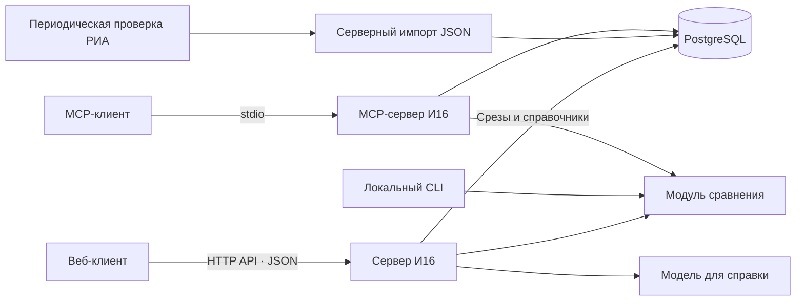

# Архитектура И16

Веб-клиент показывает форму сравнения и справку в [стиле И16](visual-style.md). Сервер отвечает за проверку запроса, получение данных и расчёт. Модуль сравнения принимает данные независимо от способа загрузки. Веб-клиент обращается к PostgreSQL через сервер.

## Данные и импорт

Миграции создают таблицы со следующими ключами и полями. Определения исходных значений приведены в [контракте импорта](data-contract.md).

| Таблица       | Ключ                            | Содержимое                                                                                                                                                                                                                                                                                          |
| -------------------- | ----------------------------------- | ------------------------------------------------------------------------------------------------------------------------------------------------------------------------------------------------------------------------------------------------------------------------------------------------------------- |
| `ratings`          | `rating_id`                       | Название рейтинга, признак демонстрационных или рабочих данных                                                                                                                                                                                         |
| `subjects`         | `(rating_id, subject_id)`         | Имя субъекта в этом рейтинге                                                                                                                                                                                                                                                          |
| `rating_snapshots` | `(rating_id, period)`             | Версия методики, границы шкалы, идентификатор охвата и размер рейтинга, название и ссылка источника, дата публикации и дополнительная ссылка на таблицу при наличии |
| `rating_results`   | `(rating_id, period, subject_id)` | Опубликованное место и балл                                                                                                                                                                                                                                                           |

Результаты ссылаются на срез и субъекта по внешним ключам. В таблице результатов допустимы равные места, отсутствующие баллы и отсутствующие места. Баллы и границы шкалы хранятся в PostgreSQL как `numeric`. Импорт проверяет файл по контракту и одной транзакцией заменяет результаты только для срезов, указанных в файле. Остальные периоды остаются в базе. Сравнение читает согласованный снимок базы в транзакции `REPEATABLE READ`. Строка подключения задаётся через `DATABASE_URL`.

## HTTP API

Локальный сервер слушает `127.0.0.1`. Для одного запуска выбирается рейтинг аргументом `--rating-id`. Веб-клиент и API обслуживаются с одного адреса.

| Запрос                                                                                       | Результат                                                                                                                                                                                                                                                                                                                                                                                                                                                   |
| -------------------------------------------------------------------------------------------------- | -------------------------------------------------------------------------------------------------------------------------------------------------------------------------------------------------------------------------------------------------------------------------------------------------------------------------------------------------------------------------------------------------------------------------------------------------------------------- |
| `GET /api/v1/rating`                                                                             | ID, название и тип рейтинга, доступные годовые срезы и справочник субъектов с ID и именами                                                                                                                                                                                                                                                                                                     |
| `GET /api/v1/comparisons?period=2025&baseline=2024&subject=demo-a&subject=demo-b&subject=demo-c` | JSON со строками сравнения в порядке показа, кратким итогом, сведениями об источниках и ограничениями. `subject` передаётся отдельно для каждого выбранного ID. Необязательные `baseline` и `focus_subject` включают сравнение с базой и разрывы по опорному субъекту. |
| `GET /api/v1/map?period=2025&baseline=2024` | Периоды, опубликованные значения и рассчитанные дельты всех доступных субъектов. Использует тот же модуль сравнения. База необязательна. |
| `GET /api/v1/refresh` | Состояние периодической проверки РИА и время последней и следующей проверок. |
| `GET /admin/` | Панель проверки источника. Требует Basic Auth при настроенном `I16_ADMIN_PASSWORD_FILE`. |
| `POST /admin/api/v1/refresh` | Запросить ручную проверку. Требует Basic Auth и пустой объект `application/json`. Возвращает `202` при принятии, `409` при выполняющейся проверке. |
| `GET /admin/api/v1/analytics` | Покрытие выпусков, пропуски и журнал проверок за последние 30 суток. Требует Basic Auth. |
| `GET /admin/api/v1/sources` | Каталог выпусков с их источниками. Требует Basic Auth. |
| `POST /admin/api/v1/sources` | Транзакционное добавление JSON-набора до 2 МиБ. Требует Basic Auth. Возвращает `201` при импорте, `409` при конфликте. |
| `POST /auth/api/v1/email` | Принимает JSON с `email`. При настроенном SMTP отправляет одноразовую ссылку и возвращает `202`. |
| `POST /auth/api/v1/verify` | Принимает JSON с `token` из ссылки. Возвращает `200` с cookie сессии или `400` для недействительной ссылки. |
| `GET /workspace/api/v1/ratings` | Email пользователя и каталог рейтингов с периодами. Требует действующую сессию. |
| `POST /auth/api/v1/logout` | По пустому JSON-объекту завершает текущую сессию и очищает cookie. |
| `POST /api/v1/help` | Возвращает ответ модели с ID разделов и `mode: llm` или ID подходящих записей справочника с `mode: reference`. |
| `POST /api/v1/briefs`                                                                            | Формирует справку с помощью ИИ для JSON-запроса с `period`, `subject_ids` и необязательными `baseline` и `focus_subject_id`. Возвращает тот же состав данных, включая краткий итог и `brief_mode` со значением `ai_assisted` или `template`.                                                                                         |

В успешном сравнении возвращаются выбранные периоды, размер рейтинга за каждый из них, исходные места и баллы, запрошенные дельты, разрывы при выборе опорного субъекта и признак частичной справки. Места и их дельты передаются целыми числами. Баллы, их дельты и разрывы передаются десятичными строками с точкой, пропуски — как JSON `null`. Клиент применяет русский формат отображения. Для `GET /api/v1/comparisons` используется `brief_mode: template`.

Успешная и частичная справки возвращаются с HTTP `200`. Ошибка параметров или полное отсутствие текущих значений у выбранных субъектов возвращается с HTTP `400`. При недоступности PostgreSQL API возвращает HTTP `503`. Для ошибок ответ содержит код и сообщение, пригодное для показа пользователю.

Клиент связывает показатели карты с локальными контурами `russia-regions.json` по `subject_id`. Контуры обобщены из Natural Earth Admin 1 версии 5.1.2 в конической проекции для обозрения России. Это справочная геометрия для визуализации статистики. [Источник геометрии](https://www.naturalearthdata.com/downloads/10m-cultural-vectors/10m-admin-1-states-provinces/), [условия использования](https://www.naturalearthdata.com/about/terms-of-use/).

Фоновая проверка РИА загружает страницу по HTTPS, сверяет контрольную выборку и передаёт изменившиеся срезы в транзакционный импорт PostgreSQL. Веб-запросы обслуживаются независимо от этой проверки. MCP-сервер запускается как локальный подпроцесс клиента и использует общий модуль сравнения и формы ответов HTTP API.

Ручная и плановая проверки используют один рабочий поток. Проверка учётных данных выполняется на HTTP-сервере для путей `/admin/`. Настройка администратора относится к локальному веб-серверу.

Таблица `rating_refresh_runs` хранит завершённые проверки по ID рейтинга, включая проверки до первого успешного импорта. Защищённая аналитика читает покрытие, счётчики и недавние записи в одной транзакции `REPEATABLE READ`.

Справочник `GET /api/v1/rating` также возвращает рекомендуемую сопоставимую базу для последнего года и ID субъектов на местах 1–3 по годам.

Справочник, сравнения, карта и справки принимают необязательный параметр URL `rating_id`. При обычном открытии используется рейтинг, настроенный при запуске. Импорт из панели блокирует запись рейтинга на время проверки конфликтов и сохраняет весь набор одной транзакцией.

Почтовая ссылка передаёт токен во фрагменте URL, клиент отправляет токен серверу после нажатия «Подтвердить вход». Миграция `003_email_access.sql` добавляет учётные записи, хеши ссылок и сессий. Погашение ссылки, создание учётной записи и сессии происходят в одной транзакции. Выдача писем ограничена одним запросом на адрес в минуту и 30 запросами в минуту на базу. HTTP-сервер слушает loopback. Для HTTPS-прокси он дополнительно принимает настроенный внешний `Host` и проверяет соответствие `Origin` для POST.

Помощник подбирает записи справочника по вопросу и текущему разделу. Сервер отправляет модели вопрос и одну найденную запись или предлагает выбрать ID из нескольких записей. При отсутствии совпадений отправляется весь справочник. Сервер проверяет форму ответа и ID тем. При отказе модели сервер возвращает подходящие ID справочника. Клиент показывает источник текста и собирает ссылки из того же справочника. Помощник и справки используют общий серверный клиент OpenAI-совместимого шлюза.

## Формирование справки

Сервер строит пакет вариантов формулировок из рассчитанных фактов. Каждый вариант связан с идентификатором факта. Модель получает схему с допустимыми ID и вариантами и возвращает упорядоченный список. Для шлюза, который отклоняет схему, используется обычный JSON-ответ. Сервер всегда проверяет известность ID, отсутствие повторов, допустимость варианта и наличие обязательных фактов. Таблица, источники и ограничения берутся из результата расчёта. При недоступности модели или невалидном ответе применяется шаблон. Настройки доступа к модели задаются в окружении сервера.
